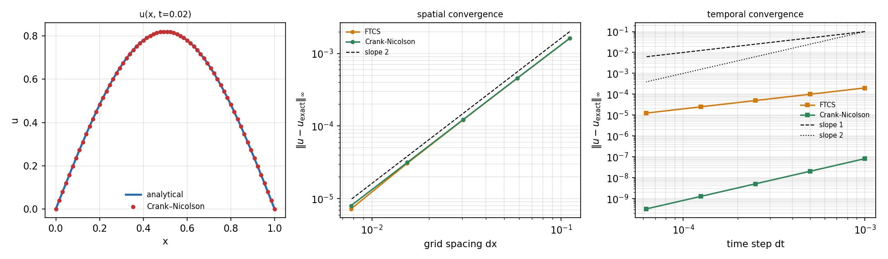

# Sparse Chaos Forecast

**Bilingual README — every section appears in English, then in 中文.**
Table headers carry both languages; the numbers appear once.

预测混沌系统时，哪个模型最好？本仓库的答案是：取决于你观测到多少状态、以及这些观测有多吵。
每一节先英文、后中文；表格用双语表头，数字只出现一次。

---

## Summary / 摘要

How does the best model for forecasting a chaotic system depend on **how much of
the state you can observe, and how noisy those observations are**? This
repository holds a reproducible benchmark over Lorenz-63 and Lorenz-96 that
compares four approaches — MLP, LSTM, transformer, and an echo-state-network
(reservoir) baseline — under one protocol, together with the failures found on
the way.

本仓库在 Lorenz-63 与 Lorenz-96 上，用同一套评估协议比较四种方法——MLP、LSTM、
Transformer，以及 reservoir（回声状态网络 ESN）基线——并记录开发过程中发现的每一处错误。

Three findings, in the order they were found:

1. **On clean observations the simplest model wins.** The MLP predicts about
   twice as long as the transformer (VPT 99.9 vs 49.2 steps, 3 seeds), and four
   times more training does not close the gap.
2. **Noise changes the ranking, but not at a single crossover.** A single-seed
   sweep suggested a crossover near σ ≈ 0.03; re-running with 3 seeds over 5
   noise levels (120 new runs) showed the LSTM overtakes the MLP only in the
   sparsest setting (17 % observed). Sparsity and noise interact.
3. **The reservoir is the worst model on clean data and the most noise-robust.**
   Under 5 % noise its one-step error degrades 24–35×, yet its rollout horizon
   *improves* 62–76 %.

三条结论（按发现顺序）：

1. **无噪声观测下，最简单的模型最好。** MLP 的 VPT 约为 Transformer 的两倍
   （99.9 对 49.2 步，3 个种子），训练预算提高到 4 倍也补不上。
2. **加噪声会改变排序，但不存在单一交叉点。** 单种子扫描曾提示 σ ≈ 0.03 附近
   有交叉；补到 3 个种子、5 个噪声水平（新增 120 组训练）后发现，LSTM 只在
   观测最稀疏（17%）时才稳定反超。**稀疏度与噪声是交互起作用的。**
3. **reservoir 在干净数据上最差，却最抗噪。** σ=5% 时它的一步误差恶化 24–35 倍，
   而闭环预测时长反而**提升 62–76%**。

> If only clean observations are reported you get "the transformer is worse than
> an MLP". Sweep the noise–sparsity plane and you get "model ranking is a
> property of the observation regime, not of the system". The latter is the point.
>
> 只跑干净观测，你会得到"Transformer 不如 MLP"；把噪声-稀疏度平面扫完，你会得到
> "模型排名不是系统的固有属性，而是观测条件的属性"。后者才是这里真正要说的事。

The benchmark setup follows [Gupta et al., *Neural Networks* 160 (2023) 297–305](https://pubmed.ncbi.nlm.nih.gov/36716509/)
("partially observable spatiotemporal chaotic systems"). All experiments are
reproducible; commands are in [Reproduction / 复现](#reproduction--复现).

基准设定参考上述论文中 "partially observable spatiotemporal chaotic systems" 的场景。
全部实验可复现，命令见「复现」一节。

---

## Results / 结果

### 1. Clean observations / 无噪声观测

VPT (Valid Prediction Time — steps until rollout RMSE crosses 0.5), mean ± std
over 3 training seeds, 80 test trajectories each.

有效预测时长 VPT（rollout RMSE 首次超过 0.5 的步数），3 个训练种子、每个 80 条测试轨迹。

| Observation retained 保留比例 | MLP | LSTM | Transformer |
|---|---|---|---|
| 1.00 (full 全观测) | **99.9 ± 2.9** | 67.5 ± 20.1 | 49.2 ± 1.3 |
| 0.50 | **83.0 ± 0.9** | 61.5 ± 11.8 | 32.0 ± 4.7 |
| 0.33 | **78.5 ± 4.5** | 74.6 ± 10.5 | 32.8 ± 5.3 |
| 0.17 | **67.9 ± 2.5** | 52.7 ± 3.3 | 29.0 ± 5.7 |

The MLP–transformer gap is 40.5–54.6 steps against seed noise of 2.7–7.8 steps
(ratio 6.4–19.8, well past the 3× threshold). Quadrupling the transformer's
training budget moved it only from 33.8 to 37.4 steps, so this is not
under-training.

MLP 与 Transformer 的差距 40.5–54.6 步，种子间噪声仅 2.7–7.8 步（比值 6.4–19.8）。
把 Transformer 训练预算提高到 4 倍，VPT 只从 33.8 涨到 37.4——不是训练不足。

### 2. Additive noise, σ = 5 % / 含噪观测

| Config 配置 | MLP | LSTM | Transformer | Best 最优 |
|---|---|---|---|---|
| c1 (1.00) | 66.5 ± 1.3 | 64.9 ± 2.0 | 44.2 ± 7.3 | MLP (marginal 略胜) |
| c2 (0.50) | 44.2 ± 0.9 | 43.8 ± 1.1 | 32.8 ± 3.6 | tie 平手 |
| c3 (0.33) | 51.1 ± 1.0 | **56.3 ± 1.4** | 32.1 ± 2.7 | LSTM |
| c4 (0.17) | 27.6 ± 0.5 | **37.5 ± 0.4** | 20.9 ± 3.5 | LSTM (+36 %) |

**Retention of the clean-observation horizon at σ = 5 % / 噪声下 VPT 保留比例**

| Config 配置 | ESN | MLP | LSTM | Transformer |
|---|---|---|---|---|
| c1 | **162 %** | 66.5 % | 96.2 % | 90.0 % |
| c2 | 87.4 % | **53.3 %** | 71.1 % | 102.4 % |
| c3 | **176 %** | 65.1 % | 75.5 % | 98.0 % |
| c4 | **105 %** | 40.6 % | 71.2 % | 72.1 % |

Among the three neural networks the MLP is the most fragile in every
configuration (retains 41–67 %), while the LSTM keeps 71–96 % and the
transformer 72–102 %. Once the reservoir is included, it is the most
noise-robust of all four.

三个神经网络中，MLP 在每一档都是最脆的（保留 41–67%），LSTM 保留 71–96%，
Transformer 保留 72–102%。把 reservoir 加进来后，它才是四者中最抗噪的那个。

Mechanism: the MLP flattens the 50-step window and maps it directly to the next
state, so noise contaminates its input statistics; the LSTM's hidden state acts
as a filter. The transformer barely changes across sparsity (49.2 → 32.0 → 32.8
→ 29.0) — not because it is robust, but because it does not make much use of the
observations at all.

机制：MLP 把 50 步窗口展平后直接映射，噪声直接污染输入统计量；LSTM 的隐状态
起滤波作用。Transformer 在不同稀疏度下几乎不变（49.2 → 32.0 → 32.8 → 29.0）——
不是因为它稳健，而是因为它基本没利用观测信息。

### 3. Reservoir baseline / reservoir 基线

| Condition 条件 | ESN | MLP | LSTM | Transformer |
|---|---|---|---|---|
| c1 clean 无噪声 | 36.2 ± 6.8 | **99.9 ± 2.9** | 67.5 ± 20.1 | 49.2 ± 1.3 |
| c4 clean 无噪声 | 40.8 ± 2.1 | **67.9 ± 2.5** | 52.7 ± 3.3 | 29.0 ± 5.7 |
| c1 σ = 0.05 | 58.7 ± 4.2 | **66.5 ± 1.3** | 64.9 ± 2.0 | 44.2 ± 7.3 |
| c2 σ = 0.05 | **45.3 ± 2.5** | 44.2 ± 0.9 | 43.8 ± 1.1 | 32.8 ± 3.6 |
| c4 σ = 0.05 | **42.8 ± 1.3** | 27.6 ± 0.5 | 37.5 ± 0.4 | 20.9 ± 3.5 |

The reservoir is worst on clean data and best under sparse-plus-noisy
observations. Its one-step MSE degrades 24–35× with noise while its rollout VPT
improves 62–76 %: a clean case of one-step accuracy decoupling from closed-loop
stability. Clean training gives a "sharp" ridge-regression readout that fits the
training distribution precisely and amplifies errors once rollout leaves it;
noisy training regularises the readout into a smoother map.

reservoir 在干净数据上最差，在稀疏且带噪时最好。它的一步 MSE 随噪声恶化 24–35 倍，
rollout VPT 反而提升 62–76%——单步精度与闭环稳定性分离的干净案例。
干净训练得到的读出层"锐利"、精确拟合训练分布，闭环一旦偏离就放大误差；
带噪训练把读出层正则化成更平滑的映射。

> Protocol note: the ESN is evaluated with a 150-step rollout and 20 trajectories
> (neural nets: 250 steps, 80 trajectories) because each reservoir step costs a
> 1500×1500 matmul. No VPT was censored at the 150-step cap (0/780), so the
> directional conclusions are unaffected.
>
> 协议差异：ESN 用 150 步 rollout、20 条轨迹（神经网络为 250 步、80 条），
> 因为 reservoir 每步要做 1500×1500 矩阵乘。已核对无 VPT 被 150 步上限截断
> （0/780），方向性结论不受影响。

### 4. Noise sweep with 3 seeds / 噪声扫描（3 种子）


Left: which model has the highest VPT in each cell. Right: LSTM − MLP difference
(blue = LSTM better).

左图：每格 VPT 最高的模型。右图：LSTM − MLP 的差值（蓝 = LSTM 更好）。

| Config 配置 | σ = 0.02 | σ = 0.05 | σ = 0.08 | σ = 0.10 | Verdict 结论 |
|---|---|---|---|---|---|
| c1 (1.00) | MLP | tie 平手 | tie 平手 | MLP | no stable winner |
| c2 (0.50) | MLP | MLP | MLP | MLP | **MLP consistently better** |
| c3 (0.33) | MLP | LSTM | tie 平手 | LSTM | no stable winner |
| c4 (0.17) | LSTM | **LSTM** | **LSTM** | **LSTM** | **LSTM consistently better** |

Significance criterion: difference / seed noise > 3. Only **c4** (17 % observed)
shows a stable LSTM advantage at σ ≥ 0.05 (+8.2 steps, ratio 3.9–6.3); c1/c2/c3
are statistically indistinguishable below σ = 0.10 (ratio 0.1–3.0).

显著性判据：差值 / 种子噪声 > 3。只有 **c4**（17% 观测）在 σ ≥ 0.05 出现稳定
LSTM 优势（+8.2 步，比值 3.9–6.3）；c1/c2/c3 在 σ ≤ 0.10 全程统计上无显著差异。

**Corrected claim / 修正后的结论:** the LSTM's advantage requires *sparsity and
noise together*. Neither alone reverses the ranking.

LSTM 的优势需要"稀疏"与"有噪"同时成立；单独一个因素不足以反转排序。


VPT versus observation noise for the four configurations. The MLP drops sharply
between σ ≈ 0.02 and 0.05; the LSTM degrades far more gently.

四个配置下 VPT 随噪声的变化。MLP 在 σ ≈ 0.02–0.05 之间断崖式下跌，LSTM 平缓得多。

> σ = 0.15 / 0.20 are single-seed only and are marked `n=1` in
> `noise_sweep_seeds.md`; they are not used for significance claims.
>
> σ = 0.15 / 0.20 只有 1 个种子，在 `noise_sweep_seeds.md` 中标注为 `n=1`，
> 不用于显著性判断。

### 5. Spatial vs temporal missingness / 空间缺失 ≠ 时间缺失

On Lorenz-96 (40 dimensions), keeping 1/6 of the observations costs two orders of
magnitude more when the missing information is *dimensions* rather than
*timesteps*:

在 Lorenz-96（40 维）上，同样只保留 1/6 观测，"缺维度"比"缺时刻"难两个数量级：

| Mask 掩码 | Semantics 语义 | test_mse | VPT |
|---|---|---|---|
| `temporal` | lower sampling rate 采样频率降低 | **0.0060** | **13.4** |
| `uniform` | fewer sensors 传感器数量减少 | 0.4906 | 0.1 |
| `block` | a region unobserved 某区域无观测 | 0.7250 | 0.0 |

Missing dimensions requires reconstructing a whole subspace; missing timesteps
only requires interpolation.

缺维度需要重建整个缺失子空间，缺时刻只需插值。

> Lorenz-96 is not usable for architecture comparison: at 30 epochs all three
> models reach VPT ≤ 10 even with full observation, i.e. they predict the mean.
> A 150-epoch run improved test_mse 3× and VPT from 9.9 to 15.8 — better, still
> not enough.
>
> Lorenz-96 不能用于架构对比：30 epoch 下三个模型即使全观测 VPT 也只有 ≤10 步，
> 基本在预测均值。补到 150 epoch 后 test_mse 改善 3 倍、VPT 从 9.9 升到 15.8，
> 有改善但仍不足。

---

## Failures found / 发现的失败

Four things went wrong during development. They are documented because a result
that has not been checked is not yet a result.

开发过程中出了四处错。记录下来，是因为没被检验过的结果不算结果。

### ① Dimension masking collapses at D = 3 / 维度掩码在 D=3 上塌缩

The first grid used dimension masks everywhere. Lorenz-63 has 3 dimensions, so
`ratio = 1/3` keeps one dimension and `ratio = 1/6` *also* keeps one — the two
masks are identical `[1, 0, 0]`, and the experiment silently repeated itself:

第一版网格用维度掩码跑全部系统。Lorenz-63 只有 3 维，`ratio=1/3` 只保留 1 维，
`ratio=1/6` **也只保留 1 维**，掩码完全相同，实验变成自我重复：

```
lorenz63_lstm_block_r0.17    VPT=56.0  RMSE@10=0.0162  growth=+0.0707
lorenz63_lstm_uniform_r0.33  VPT=56.0  RMSE@10=0.0162  growth=+0.0707   ← identical
```

Fix: added a `temporal` masking mode, which realises any ratio at any dimension.
A regression test in `test_pipeline.py` pins the failure.

修正：新增 `temporal` 模式，在任意维数下都能精确实现任意比例；`test_pipeline.py`
里加入针对性回归测试。

### ② Ratio precision silently dropped data / 精度不匹配导致静默丢数据

After the multi-seed run, the report emitted only 2 of 4 configurations. `run_id`
stores the ratio to two decimals (`r0.33`) while the config holds `1/3`; the
filter `abs(a-b) < 1e-9` therefore excluded c3 and c4 without any error.

多种子实验跑完 36 组后，报告只输出 2/4 个配置。`run_id` 里 ratio 是两位小数
（`r0.33`），配置里是 `1/3`，筛选条件 `abs(a-b) < 1e-9` 把 c3/c4 静默排除了。

Fix: tolerance comparison (`< 0.006`) plus an explicit completeness check that
warns when a configuration has too few results.

修正：改用容差比较（`< 0.006`），并加入完整性校验，结果不足时明确告警。

### ③ A single-seed phase diagram gave a false conclusion / 单种子相图给出假结论

The first sweep trained one seed per condition and produced a phase diagram
suggesting "the LSTM takes over for σ ≥ 0.05, crossover near σ ≈ 0.03".
Re-running 120 new models over 3 seeds showed the crossover does not exist as
stated; see section 4.

第一版扫描每个条件只训一个种子，相图显示"σ ≥ 0.05 后 LSTM 接管，交叉点在
σ ≈ 0.03"。补 120 组新训练后该结论不成立，见第 4 节。

### ④ Two heat-equation tests were wrong, not the code / 热方程的两个测试本身是错的

1. **The stability test used a smooth initial condition.** `sin(πx)` contains only
   the lowest mode, while the r > 1/2 instability lives in the highest grid mode.
   Since modes evolve independently in a linear scheme, a smooth initial condition
   never excites it — at r = 0.6 the solution still decayed (max|u| = 0.605).
   Adding a 1e-3 amplitude highest-mode perturbation made it blow up to 3.2e7.
2. **The temporal-order study violated the stability condition.** With
   n_grid = 40, `n_steps = 20` gives r ≈ 1.68 — the scheme was already unstable
   and the measured "errors" were divergence, producing orders of 6.87 and −0.50.
   Fixed by comparing against the *semi-discrete* exact solution and keeping every
   dt within r ≤ 0.5.

1. **稳定性测试用了光滑初值。** `sin(πx)` 只含最低频模态，而 r>1/2 的失稳发生在
   最高频网格模态；线性格式下各模态独立演化，光滑初值永远不激发它——r=0.6 时
   解照样衰减（max|u|=0.605）。加一个 1e-3 的最高频扰动后才炸到 3.2e7。
2. **时间阶研究违反了稳定性条件。** n_grid=40 时 `n_steps=20` 对应 r≈1.68，
   格式本身已失稳，测出的"误差"是发散量，给出 6.87 与 −0.50 这种无意义阶数。
   改为与**半离散精确解**比较、且让所有 dt 满足 r≤0.5。

---

## Methods / 方法

**Task / 任务.** From a masked window of L = 50 past steps, predict the next
full state. Targets are never masked; only inputs are zero-filled where
unobserved.

用被掩码的过去 L=50 步预测下一时刻的完整状态。target 从不掩码，只有输入在
未观测处补零。

**Models / 模型.** MLP (105 k parameters, flattened input), LSTM (201 k, 2×128),
transformer (531 k, 4 layers, d = 128, 4 heads). Identical hyperparameters across
models — no per-model tuning, otherwise "which is better" is not answerable.

MLP（105k 参数，展平输入）、LSTM（201k，2×128）、Transformer（531k，4 层 d=128
4 头）。超参在模型间完全统一——不对任何模型单独调参，否则"谁更好"无法回答。

**Data / 数据.** Lorenz-63: 1000 × 400 × 3 train, 200 × 800 × 3 test.
Lorenz-96: 300 × 500 × 40 train, 100 × 1000 × 40 test. RK4 with dt = 0.01,
sampled every 5 steps (ds = 0.05). 1000 transient samples discarded per
trajectory; normalisation statistics come from the training set only.

Lorenz-63：训练 1000×400×3，测试 200×800×3。Lorenz-96：训练 300×500×40，
测试 100×1000×40。RK4，dt=0.01，每 5 步采样（ds=0.05）。每条轨迹先丢弃 1000 个
瞬态采样点；标准化统计量只取自训练集。

**Evaluation / 评估.** Autoregressive rollout (250 steps), feeding predictions
back as input. VPT = first step where RMSE exceeds 0.5 (standardised scale);
RMSE@10 = error over the first 10 steps; growth rate = slope of log-RMSE.

自回归 rollout（250 步），把预测值反馈为输入。VPT = RMSE 首次超过 0.5（标准化
尺度）的步数；RMSE@10 = 前 10 步误差；growth rate = log-RMSE 的增长斜率。

**Scale / 规模.** 378 trained models: main grid 51, multi-seed 36, noise 48,
noise sweep 84, seed supplement 120, reservoir 39. RTX 3060 Laptop.

共 378 个训练模型：主网格 51、多种子 36、含噪 48、噪声扫描 84、种子补充 120、
reservoir 39。硬件：RTX 3060 Laptop。

---

## Reproduction / 复现

```bash
pip install -r requirements.txt

# 1) Data (about 9 s) / 生成数据
python data/generate.py --system all

# 2) Self-checks / 自检
python -m masking --selfcheck
python test_pipeline.py            # 30+ assertions, includes the masking regression test

# 3) Main grid (about 25 min, resumable) / 主网格
python run_grid.py --epochs 30

# 4) Rollout evaluation (about 12 min) / rollout 评估
python evaluate.py --all --roll-t 250 --n-traj 40

# 5) Aggregation and plots / 汇总与出图
python summarize.py
python plot_history.py

# 6) Multi-seed robustness (about 28 min) / 多种子稳健性
python run_seeds.py

# 7) Noise experiment (about 50 + 25 min) / 含噪实验
python run_noise.py

# 8) Noise sweep + phase diagram / 噪声扫描与相图
python run_noise_sweep.py
python plot_phase.py

# 9) Seed supplement for the sweep (about 40 + 60 min) / 扫描种子补充
python run_sweep_seeds.py

# 10) Reservoir baseline / reservoir 基线
python run_reservoir.py

# 11) Heat equation solver + convergence checks (seconds) / 热方程
python heat_equation.py --plot
```

> Checkpoints and generated trajectories are git-ignored (about 440 MB). Running
> the commands above reproduces them from source.
>
> 检查点与生成的轨迹已被 git 忽略（约 440 MB）。按上述命令可从源码重建。



The heat-equation module verifies measured convergence orders by assertion rather
than printing them: 2.03 / 1.99 in space and 1.00 / 2.00 in time for FTCS and
Crank–Nicolson, with the FTCS stability limit reproduced.

热方程模块把收敛阶写成断言而不是打印：FTCS 与 Crank–Nicolson 的空间阶为
2.03 / 1.99，时间阶为 1.00 / 2.00，并复现了 FTCS 的稳定性边界。

---

## Repository layout / 目录

```
.
├── data/generate.py          # vectorised RK4 trajectory generation
├── masking.py                # 5 mask modes + standardisation + windowing + noise
├── train.py                  # MLP / LSTM / transformer, unified training loop
├── evaluate.py               # rollout, VPT, plots
├── reservoir.py              # echo-state-network baseline + self-checks
├── heat_equation.py          # 1D heat equation FD solver + convergence checks
├── run_grid.py               # main grid driver (resumable)
├── run_seeds.py              # multi-seed repetition + robustness verdicts
├── run_noise.py              # additive-noise experiment
├── run_noise_sweep.py        # single-seed noise sweep
├── run_sweep_seeds.py        # seed supplement for the sweep
├── run_reservoir.py          # reservoir baseline experiment
├── plot_phase.py             # phase diagram
├── summarize.py              # tables + CSV + findings
├── plot_history.py           # training curves
├── test_pipeline.py          # data / masking / windowing assertions
├── README.md                 # this file (bilingual)
├── RESERVOIR_GUIDE.md        # reservoir design, failures, tuning table
├── RESULTS_GUIDE.md          # how to read the results (method, not numbers)
├── seed_results.md           # multi-seed tables (generated)
├── noise_results.md          # noise experiment tables (generated)
├── noise_sweep.md            # single-seed sweep ⚠️ superseded
├── noise_sweep_seeds.md      # 3-seed sweep ✅ authoritative
└── reservoir_results.md      # reservoir vs neural nets (generated)
```

Generated result files are in Chinese; the code comments are in Chinese as well.
English translations of individual sections can be provided on request.

自动生成的结果文件与代码注释为中文；如需某节英文全文可另行提供。

---

## Next steps / 下一步

| Priority 优先级 | Task 任务 | Why 理由 |
|---|---|---|
| high 高 | Seed supplement for σ = 0.15 / 0.20 | currently `n=1`, unusable for significance 当前只有 1 个种子 |
| medium 中 | Stronger Lorenz-96 baselines | all models underfit; architecture comparison invalid 三模型都欠拟合 |
| medium 中 | Non-recurrent reference models (latent dynamics, neural ODE) | to test whether any learned dynamics helps |
| low 低 | Multi-step direct prediction | current setup is single-step + rollout |
| low 低 | 2D or variable-coefficient heat equation | stronger PDE evidence |

---

## Environment / 环境

Python 3.11 · numpy 2.4.6 · torch 2.13.0 (CUDA 12.6) · matplotlib 3.9.2 ·
NVIDIA RTX 3060 Laptop (6 GB).

## License

MIT — see [LICENSE](LICENSE).
