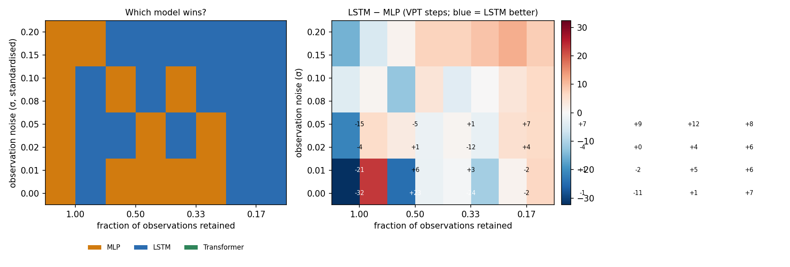
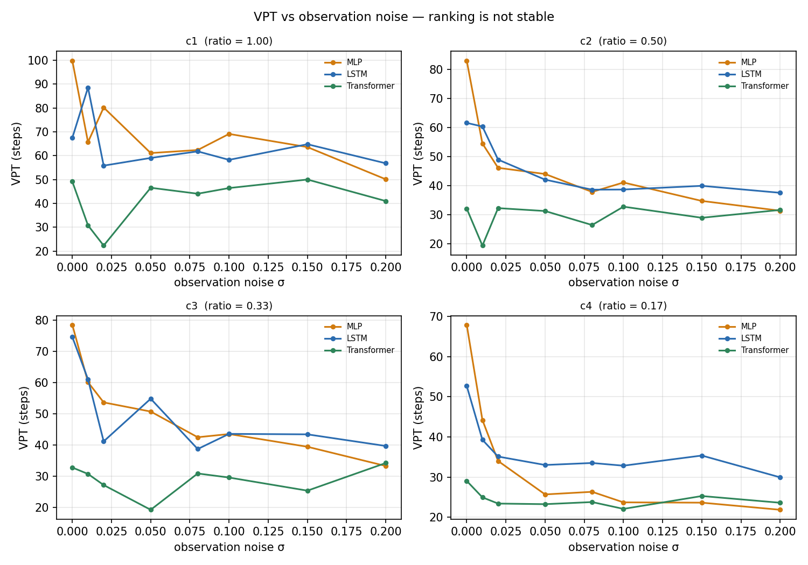

# Sparse Chaos Forecast

How does the best model for forecasting a chaotic system depend on **how much of
the state you can observe, and how noisy those observations are**?

This repository holds a reproducible benchmark over Lorenz-63 and Lorenz-96 that
compares four approaches — MLP, LSTM, transformer, and an echo-state-network
(reservoir) baseline — under one protocol, together with the failures I found
along the way.

**研究问题**：当动力系统只能被部分观测时，Transformer 相对 LSTM 的预测优势，
是否依赖于系统本身的动力学特性？

本仓库复现并扩展 [Gupta et al., *Neural Networks* 160 (2023) 297–305](https://pubmed.ncbi.nlm.nih.gov/36716509/)
中 "partially observable spatiotemporal chaotic systems" 的预测设定。

---

## 结论（先说结果）

**三条，按重要性排序：**

1. **干净观测下，最简单的模型最好**：MLP 的 VPT 是 Transformer 的两倍（99.9 vs 49.2），
   且 4 倍训练预算不能缩小差距。
2. **加 5% 噪声后排序被改写**：MLP 只剩 41–67% 的预测horizon，LSTM 保留 71–96%，
   最优模型变成 LSTM。
3. **加入 reservoir（Gupta 论文同族方法）后出现第三个反转**：
   reservoir 在干净数据上最差（36.2 vs MLP 99.9），
   **但它是四个模型里最抗噪的**——在 c1/c3 上加噪后 VPT 反而提升 62%/76%，
   并在稀疏+有噪条件下成为最优（c4: 42.8 vs LSTM 37.5 vs MLP 27.6）。

**所以"哪个模型好"没有单一答案：它取决于观测质量。**
这一点在只跑干净数据的基准里完全看不出来。

### 无噪声（3 种子 × 80 条测试轨迹，统一评估协议）

| 观测比例 | MLP | LSTM | Transformer |
|---|---|---|---|
| 1.00（全观测） | **99.9 ± 2.9** | 67.5 ± 20.1 | 49.2 ± 1.3 |
| 0.50 | **83.0 ± 0.9** | 61.5 ± 11.8 | 32.0 ± 4.7 |
| 0.33 | **78.5 ± 4.5** | 74.6 ± 10.5 | 32.8 ± 5.3 |
| 0.17 | **67.9 ± 2.5** | 52.7 ± 3.3 | 29.0 ± 5.7 |

MLP 与 Transformer 的差距 40.5–54.6 步，种子间噪声仅 2.7–7.8 步，
**比值 6.4–19.8，远超 3 倍判定线**。所以"无噪声下 MLP 明显最好"不是噪声。

### 加入观测噪声（σ = 5%，相对于标准化尺度）

| 配置 | MLP | LSTM | Transformer | 谁最优 |
|---|---|---|---|---|
| c1 全观测 | 66.5 ± 1.3 | 64.9 ± 2.0 | 44.2 ± 7.3 | MLP（勉强） |
| c2 ratio 0.50 | 44.2 ± 0.9 | 43.8 ± 1.1 | 32.8 ± 3.6 | MLP（平手） |
| c3 ratio 0.33 | 51.1 ± 1.0 | **56.3 ± 1.4** | 32.1 ± 2.7 | **LSTM** |
| c4 ratio 0.17 | 27.6 ± 0.5 | **37.5 ± 0.4** | 20.9 ± 3.5 | **LSTM**（+36%） |

**8 个（配置 × 噪声）条件下，有 5 个的最优模型不再是 MLP，全部由 LSTM 接管。**

### 为什么：MLP 对噪声最脆

σ=5% 时各模型 VPT 的**保留比例**（含 reservoir，见下节）：

| 配置 | ESN | MLP | LSTM | Transformer |
|---|---|---|---|---|
| c1 | **162%** | 66.5% | 96.2% | 90.0% |
| c2 | 87.4% | **53.3%** | 71.1% | 102.4% |
| c3 | **176.0%** | 65.1% | 75.5% | 98.0% |
| c4 | **105.0%** | **40.6%** | 71.2% | 72.1% |

**在三个神经网络中，MLP 在每一个配置里都是最脆的**（保留 41–67%），
LSTM 保留 71–96%、Transformer 保留 72–102%。
但把 reservoir 加进来后，**它才是最抗噪的那个**（保留 87–176%，
在 c1/c3 上甚至加噪后更好）。

机制解释：MLP 把 50 步输入展平后直接映射，靠精确拟合观测模式；噪声直接污染了
它的输入统计量。LSTM 的隐状态传递本身构成一种滤波，对输入扰动更鲁棒。
**Transformer 在 c2 甚至略有提升（102.4%）**，说明在低维任务上它更多是在做
某种平均而非精确映射——这解释了它为何在无噪声时本来就差。

**这是一个比"哪个模型更好"更有价值的结论**：模型排名不是系统的固有属性，
它依赖于观测质量。在稀疏且带噪的真实传感器场景下，选择简单模型作为基线是有风险的。

详细数据见 [`noise_results.md`](noise_results.md)、[`seed_results.md`](seed_results.md)、[`summary.csv`](summary.csv)。

---

## Reservoir 基线：第三个反转

Gupta 的论文用的是 reservoir computing，所以原有三模型对比缺一个关键参照。
补上之后（实现与调参见 [`RESERVOIR_GUIDE.md`](RESERVOIR_GUIDE.md)）：

| 条件 | ESN | MLP | LSTM | Transformer | 最优 |
|---|---|---|---|---|---|
| c1 无噪声 | 36.2 ± 6.8 | **99.9 ± 2.9** | 67.5 ± 20.1 | 49.2 ± 1.3 | MLP |
| c4 无噪声 | 40.8 ± 2.1 | **67.9 ± 2.5** | 52.7 ± 3.3 | 29.0 ± 5.7 | MLP |
| c1 σ=0.05 | 58.7 ± 4.2 | **66.5 ± 1.3** | 64.9 ± 2.0 | 44.2 ± 7.3 | MLP |
| c2 σ=0.05 | **45.3 ± 2.5** | 44.2 ± 0.9 | 43.8 ± 1.1 | 32.8 ± 3.6 | **ESN** |
| c4 σ=0.05 | **42.8 ± 1.3** | 27.6 ± 0.5 | 37.5 ± 0.4 | 20.9 ± 3.5 | **ESN** |

**reservoir 在干净观测上最差，却是最抗噪的；在稀疏+有噪条件下成为最优。**

更值得注意的是那个反直觉现象：ESN 的一步 MSE 随噪声**恶化 24–35 倍**，
但 rollout VPT 反而**提升 62–76%**。这是"单步精度与闭环稳定性分离"的干净案例：

- 干净训练 → 岭回归读出精确拟合训练分布 → 映射"锐利" → 闭环一旦偏离分布，误差被放大
- 带噪训练 → 噪声对读出层起正则化作用 → 映射"平滑" → 单步变差，但闭环不放大误差

所以 reservoir 的优势**不在于表达力，而在于它的读出层被噪声正则化成了更稳定的动力学**。

> ⚠️ 协议差异：ESN 的评估用 150 步 rollout、20 条轨迹（神经网络为 250 步、80 条），
> 因为 reservoir 每次 rollout 要重跑 50 步 1500×1500 矩阵乘。
> 已核对无 VPT 被 150 步截断（0/780），方向性结论不受影响。

### 噪声扫描：相图（7 个噪声水平 × 4 配置 × 3 模型 = 84 组，单种子）



**左图**：每格是 VPT 最高的模型。**右图**：LSTM − MLP 的差值（蓝 = LSTM 更好）。



**MLP 在 σ ≈ 0.02–0.05 之间出现断崖式下跌**（c1: 100 → 66；c4: 68 → 28），
此后趋于平台但多数格子低于 LSTM。LSTM 本身也从 100 掉到约 50–60，但跌幅小得多。
**Transformer 从未在任何一格中成为最优。**

> ⚠️ **这一节是单种子结果，其结论已被下一节推翻。保留它是因为它说明了
> "单种子相图会给出过度自信的结论"——这本身是个值得记录的教训。**

### ⚠️ 单种子结论被多种子推翻：没有 σ ≈ 0.03 的交叉点

上面那张相图曾让人相信"σ ≥ 0.05 后 LSTM 接管，交叉点在 σ ≈ 0.03"。
补到 **3 个训练种子**（5 个噪声水平，共 120 组新训练）后，这个结论不成立：

| 配置 | σ=0.02 | σ=0.05 | σ=0.08 | σ=0.10 | 结论 |
|---|---|---|---|---|---|
| c1 全观测 | MLP | 平手 | 平手 | MLP | 无稳定领先 |
| c2 r=0.50 | MLP | MLP | MLP | MLP | **MLP 一直更好** |
| c3 r=0.33 | MLP | LSTM | 平手 | LSTM | 无稳定领先 |
| c4 r=0.17 | LSTM | **LSTM** | **LSTM** | **LSTM** | **LSTM 稳定领先** |

显著性判据：差值 / 种子噪声 > 3。只有 **c4**（最稀疏，17% 观测）在
σ ≥ 0.05 出现稳定的 LSTM 优势（+8.2，比值 3.9–6.3）。
c1/c2/c3 在 σ ≤ 0.10 全程**统计上无显著差异**（比值 0.1–3.0）。

**修正后的结论是交互效应，不是单因素**：

> **LSTM 的优势需要"稀疏"与"有噪"同时成立。**
> 观测足够多时（c1–c3），两个模型在 σ ≤ 0.10 打平；
> 只有最稀疏的 c4 才让循环结构真正占便宜。

这比"Crossover at 0.03"更有信息量，也更难被推翻——因为它不依赖某个具体阈值。

> 补充：σ=0.15 / 0.20 两档只有 1 个训练种子，`noise_sweep_seeds.md` 中以 `n=1` 标出，
> **不用于显著性判断**。

完整数据：[`noise_sweep_seeds.md`](noise_sweep_seeds.md)（3 种子）与
[`noise_sweep.md`](noise_sweep.md)（单种子，已被推翻）。

---

## 三个次级的观察

**无噪声条件下：**

1. **Transformer 的 VPT 曲线几乎是平的**（49.2 → 32.0 → 32.8 → 29.0）。
   观测密度从 100% 降到 17%，它的表现变化很小——说明它**没有真正利用观测信息**，
   而不是"对稀疏化稳健"。
2. **它的单步 `test_mse` 也最差**（0.00004–0.00094，MLP 为 0.00002–0.00004），
   且随稀疏化恶化最快（23 倍）。
3. **排除训练不足**：Transformer 从 30 epoch 训到 120 epoch（lr 3e-4），
   VPT 仅 33.8 → 37.4，RMSE@10 基本不变（0.0396 → 0.0402）。差距不是训练量造成的。


详细数据见 [`summary.csv`](summary.csv)、[`seed_results.md`](seed_results.md)、[`findings.md`](findings.md)。

---

## 失败记录 ①：维度掩码在 D=3 上塌缩

**第一版网格用维度掩码跑全部系统，结果是错的。**

Lorenz-63 只有 3 维，`ratio=1/3` 只能保留 1 维，`ratio=1/6` **也只能保留 1 维**，
于是两者掩码完全相同 `[1, 0, 0]`，实验变成自我重复。表现是三个指标一模一样：

```
lorenz63_lstm_block_r0.17    VPT=56.0  RMSE@10=0.0162  growth=+0.0707
lorenz63_lstm_uniform_r0.33  VPT=56.0  RMSE@10=0.0162  growth=+0.0707   ← 完全相同
```

**修正**：新增 `temporal` 模式（时间维稀疏化），在任意 D 上都能精确实现任意比例：

```
uniform  r=1/3 -> [1, 0, 0]                  只看见 1 个维度
uniform  r=1/6 -> [1, 0, 0]                  与上面完全相同 ← 塌缩
temporal r=1/3 -> [1,0,0,1,0,0,1,0,0]        维度全可见，只保留 1/3 时刻
```

`test_pipeline.py` 中加入了针对这个坑的**回归测试**，防止再次踩中。

---

## 失败记录 ②：ratio 精度不匹配导致报告静默丢数据

多种子实验跑完 36 组后，报告只输出了 2/4 个配置。

根因：`run_id` 里 ratio 写成两位小数（`r0.33`），而配置里是 `1/3 = 0.3333...`，
两者相差 0.0033。筛选条件用了 `abs(a-b) < 1e-9`，于是 c3/c4 被静默排除。

**修正**：改用容差比较（`< 0.006`），并加入**完整性校验**——
配置对应的结果不足时明确告警，而不是静默跳过。

---

## 失败记录 ③：单种子相图给出了假结论

第一版噪声扫描每个条件只训一个种子，得出的相图显示"σ ≥ 0.05 后 LSTM 接管"。
补到 3 个种子后（120 组新训练），这个结论不成立——详见上文
「单种子结论被多种子推翻」。

---

## 失败记录 ④：热方程的两个测试本身是错的

实现 FTCS 与 Crank–Nicolson 后，头两次验证都失败，但**代码是对的，测试是错的**：

1. **稳定性测试用光滑初值**：`sin(πx)` 只含最低频模态，而 r>1/2 的失稳发生在
   最高频网格模态。线性格式下各模态独立演化，光滑初值永远不会激发高频——
   所以 r=0.6 时解照样衰减（实测 max|u| = 0.605，与稳定情形几乎一样）。
   修正：在初值里加一个 1e-3 的最高频扰动，才看到 3.2e7 的爆炸。

2. **时间阶研究违反了稳定性条件**：n_grid=40 时 dx² ≈ 5.95e-4，
   取 n_steps=20（dt=1e-3）对应 r ≈ 1.68——格式本身已失稳，
   测出的"误差"是发散量，阶数出现 6.87 与 -0.50 这类无意义值。
   修正：改用**半离散精确解**作参考（排除空间误差），且让所有 dt 满足 r ≤ 0.5。

> 这四次失败指向同一件事：**"跑完了"不等于"结果对了"**。
> 所以 `heat_equation.py` 把收敛阶写成 `assert` 而不是 `print`——
> 阶数偏离 2 就直接报错，而不是留给人去看。

---

## 空间缺失 ≠ 时间缺失

Lorenz-96（40 维）上，同样保留 1/6 的观测，两种稀疏化的难度差了两个数量级：

| 掩码模式 | 语义 | test_mse | VPT |
|---|---|---|---|
| `temporal` | 采样频率降低（全维度可见） | **0.00596** | **13.4** |
| `uniform` | 传感器数量减少（等间隔维度） | 0.49057 | 0.1 |
| `random` | 传感器位置固定（随机维度） | 0.53035 | 0.0 |
| `block` | 某片区域无观测（连续维度） | 0.72499 | 0.0 |

**结论**：丢失"哪些维度"和丢失"多少时刻"是完全不同难度的问题。
前者需要重建整个缺失子空间，后者只需插值。

---

## ⚠️ Lorenz-96 的结果目前不可用于比较

30 epoch 下，**所有三个模型**在完全观测时 VPT 都只有 3–10 步（`test_mse` 0.003–0.032），
即基本在预测均值。长训练验证：Transformer 训到 150 epoch 后 `test_mse` 改善 3 倍
（0.0026 → 0.00085），VPT 从 9.9 升到 15.8 —— **有改善但依然不足**。

**因此 Lorenz-96 的架构间对比在本轮实验中不成立**，只能用于说明
"空间 vs 时间稀疏化"的难度差异（见上一节）。要得到可信结论，
需要更强的模型（更大容量、更长训练、或专门的 latent dynamics 方法）。

诚实标注比强行给结论重要。

---

## 方法

**任务**：从被遮挡的过去 `L=50` 步预测未来完整状态（单步）。

```
target = x_{t+1}                  ← 永远完整，从不 mask
input  = x_{t-49 .. t} ⊙ mask     ← 被遮挡，缺失位置填 0
```

**模型**（超参在模型间保持统一，避免"给某个模型单独调参"）：

| 模型 | 配置 | 参数量 |
|---|---|---|
| MLP | 2 层 256 隐，展平输入 | 105k |
| LSTM | 2 层 128 隐 | 201k |
| Transformer | 4 层 d=128 4 头，时间位置编码 | 531k |

**数据**（RK4，`dt=0.01`，每 5 步采样 即 `ds=0.05`）：

| | train | test |
|---|---|---|
| lorenz63 | 1000 × 400 × 3 | 200 × 800 × 3 |
| lorenz96 | 300 × 500 × 40 | 100 × 1000 × 40 |

**评估**：自回归 rollout 250 步，每步把预测值反馈回输入窗口并继续施加同一掩码。
- **VPT**：RMSE 首次超过 0.5（标准化尺度）的时刻
- **RMSE@10**：前 10 步平均误差
- **growth rate**：误差对数增长斜率

**规模**：51 组实验（2 系统 × 3 模型 × 各自适用的掩码-比例组合），
30 epoch，25.2 分钟训练 + 11.5 分钟评估（RTX 3060 Laptop）。

---

## 复现

```bash
# 1) 生成数据（约 9 秒）
python data/generate.py --system all

# 2) 自检
python -m masking --selfcheck
python test_pipeline.py          # 30+ 断言，含 temporal 回归测试

# 3) 全量网格（约 25 分钟，支持断点续跑）
python run_grid.py --epochs 30

# 4) rollout 评估（约 12 分钟）
python evaluate.py --all --roll-t 250 --n-traj 40

# 5) 汇总与出图
python summarize.py
python plot_history.py

# 6) 多种子稳健性检验（约 28 分钟训练 + 评估，支持断点续跑）
python run_seeds.py
python run_seeds.py --report-only    # 只重出表

# 7) 含噪观测实验（约 50 分钟训练 + 25 分钟评估）
python run_noise.py
python run_noise.py --report-only

# 8) 噪声扫描 + 相图（约 80 分钟训练 + 40 分钟评估）
python run_noise_sweep.py
python plot_phase.py                # 生成 figs/phase_diagram.png 与 noise_curves.png

# 9) 噪声扫描多种子补充（约 40 分钟训练 + 60 分钟评估）
python run_sweep_seeds.py
python run_sweep_seeds.py --report-only

# 10) reservoir 基线（约 47 分钟训练 + 评估）
python run_reservoir.py
python run_reservoir.py --report-only

# 11) 热方程求解器与收敛阶验证（秒级）
python heat_equation.py --plot
```

> **注意**：含噪实验的基线必须用与含噪组相同的评估协议
> （`evals_seeds_re/`，2 个评估种子 × 40 条 = 80 条），
> 否则 std 不可比。`run_noise.py` 会自动优先读取该目录并给出提示。

---

## 目录

```
.
├── data/
│   ├── generate.py           # 向量化 RK4，生成两套系统
│   └── *.npy / *_meta.json
├── masking.py                # 5 种掩码 + 标准化 + 窗口切分 + 观测噪声
├── train.py                  # 三个模型 + 统一训练循环（--seed / --noise）
├── evaluate.py               # rollout / VPT / 出图（多种评估种子 + 噪声）
├── reservoir.py              # Echo State Network 基线与自检
├── heat_equation.py          # 1D 热方程 FD 求解器 + 收敛阶验证
├── run_grid.py               # 主网格驱动（断点续跑）
├── run_seeds.py              # 多种子重复实验 + 稳健性判定
├── run_noise.py              # 含噪观测实验（含跨模型反转检测）
├── run_noise_sweep.py        # 噪声扫描（单种子，7 水平）
├── run_sweep_seeds.py        # 噪声扫描种子补充（seed 1/2）
├── run_reservoir.py          # reservoir 基线实验
├── plot_phase.py             # 相图：哪个模型在哪个区域最优
├── summarize.py              # 汇总表 + CSV + findings
├── plot_history.py           # 训练曲线
├── test_pipeline.py          # 地基验收
├── RESULTS_GUIDE.md          # 结果解读方法论（怎么从数据写出结论）
├── RESERVOIR_GUIDE.md        # reservoir 设计、失败记录与结论
├── seed_results.md           # 多种子结果（自动生成）
├── noise_results.md          # 含噪结果（自动生成）
├── noise_sweep.md            # 噪声扫描单种子 ⚠️ 已被推翻
├── noise_sweep_seeds.md      # 噪声扫描 3 种子 ✅ 以此为准
├── reservoir_results.md      # ESN vs 神经网络（自动生成）
└── README.md
```

---

## 下一步

| 优先级 | 任务 | 理由 |
|---|---|---|
| 高 | **σ=0.15/0.20 补种子** | 目前只有 1 个种子（`n=1`），不能用于显著性判断 |
| 中 | 强化 Lorenz-96 基线 | 当前所有模型都欠拟合，架构对比不成立 |
| 中 | 更强的时序模型 | 如 latent dynamics / neural ODE，作为参照 |
| 低 | 多步直接预测 | 当前只做单步 + rollout |
| 低 | 热方程换到 2D 或变系数 | 当前只有 1D 常系数，作为 PDE 能力的证据够了 |
| ✅ | ~~多随机种子重复~~ | 4 配置 × 3 模型 × 3 种子 |
| ✅ | ~~含噪观测实验~~ | 2 噪声水平 × 4 配置 × 3 模型 × 2 种子 |
| ✅ | ~~噪声扫描相图~~ | 7 噪声水平 × 4 配置 × 3 模型（单种子） |
| ✅ | ~~噪声扫描补种子~~ | 5 噪声水平 × 4 配置 × 3 模型 × 3 种子（共 120 组新训练） |
| ✅ | ~~reservoir 基线~~ | 39 组，含两次实现失败的记录 |
| ✅ | ~~热方程求解器~~ | FTCS + Crank–Nicolson，收敛阶已验证 |

---

## 环境

- Python 3.11 / numpy 2.4.6 / torch 2.13.0 (CUDA 12.6) / matplotlib 3.9.2
- GPU: NVIDIA RTX 3060 Laptop
